<p align="center"></p>

# URMA Node

An optional archive node for the [URMA protocol](https://github.com/urma-protocol/urma).
It contains:

- `urma-node`: a daemon that follows Litecoin, then scans, verifies, stores and serves URMA records. It
  exchanges records with other nodes over a libp2p overlay. The crate also builds `urma-node-control`, a
  loopback operator CLI.
- `urma-node-app`: a Tauri desktop app that shows a local node's status.

Nothing in URMA requires a node. The CLI, Wire, Names, Web and Git clients use
one only when it is explicitly configured. Verification rules belong to the
libraries, and the node never relaxes them.

## Build

Requires a Rust stable toolchain. The library crates (`urma-chain`, `urma-core`, `urma-io`,
`urma-names`, `urma-runtime`, `urma-wire`, `urma-node-client`) are git
dependencies pinned to one commit of the main repository in `Cargo.toml`.

```sh
cargo install --locked --path urma-node      # urma-node, urma-node-control
cargo test --locked -p urma-node
```

The app also needs Node.js, pnpm and WebKitGTK 4.1:

```sh
urma-node-app/install.sh                     # binary, icon, desktop entry under ~/.local
```

The script builds with `pnpm tauri build --no-bundle`. For development, run
`pnpm install && pnpm tauri dev` in `urma-node-app/`. See
[urma-node-app/README.md](urma-node-app/README.md).

## Run on Litecoin testnet

[`urma-node/contrib/dev/local-node.sh`](urma-node/contrib/dev/local-node.md)
creates the archive, config, token and peer key, then runs `serve`. It also prints
the `archive` entry that the app and the CLI read from `~/.config/urma/config.json`.

The application start is part of the archive identity. Pick a block at or after
the embedded checkpoint (Litecoin testnet 4,904,927):

```sh
export URMA_NODE=$(command -v urma-node)
urma-node/contrib/dev/local-node.sh ~/urma-tltc p2p \
    --start-height 4905000 --start-hash "$(litecoin-cli -testnet getblockhash 4905000)"
```

Without `litecoin-cli`, get the hash from
`https://litecoinspace.org/testnet/api/block-height/4905000`.

`--chain-peer IP:PORT` (repeatable) pins the Litecoin peers that headers and
blocks come from, instead of DNS seeds.

`local-node.sh` is the development flow. It does not accept a local Litecoin
Core or an inbound URMA listener (`--commit-rpc-*`, `--urma-listen`). For
those, run `urma-node serve` yourself, or use the
[user unit](urma-node/contrib/systemd/urma-node.service) and its
[operator checklist](urma-node/contrib/OPERATOR.md). The unit runs:

```sh
urma-node \
    --data ~/.local/share/urma/node-testnet/data \
    --config ~/.local/share/urma/node-testnet/config.json serve \
    --listen 127.0.0.1:28331 \
    --token-file ~/.local/share/urma/node-testnet/service.token \
    --p2p \
    --peer-key ~/.local/share/urma/node-testnet/peer.key \
    --urma-listen 0.0.0.0:28332 \
    --commit-rpc-url http://127.0.0.1:19332 \
    --commit-rpc-cookie ~/.local/share/litecoin/testnet4/.cookie
```

Litecoin Core is optional. The daemon starts without it, and the `local-rpc`
entry in `commit_sources` follows litecoind as it starts and stops. See also
the generic [systemd template](urma-node/contrib/systemd/README.md) and the
full daemon reference in [urma-node/README.md](urma-node/README.md).

## Status contract

`GET /v1/status` and the other loopback routes are typed in
[`urma-node-client`](https://github.com/urma-protocol/urma/tree/master/urma-node-client)
in the main repository. Its `API_VERSION` versions the contract. The app
reads status through that client.

## License

0BSD, see [LICENSE](LICENSE).
